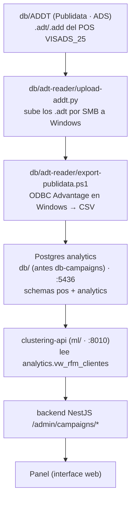

# Migración de la réplica de analytics

Documentación del **origen**, **cómo se pobló** y **cómo reconstruir** la base
`analytics` (carpeta `db/`, contenedor `analytics_postgres`, puerto 5436) que
alimenta la segmentación de campañas del panel (`interface web/`).

> Esta BD es una **réplica de solo lectura del legado** y **no tiene nada que ver
> con la BD transaccional del ecommerce** (esa vive en el repo `ecommerce`, en su
> propio `db/docker/`, puerto 5432).

## 1. Origen: Publidata (Advantage Database Server)

Los datos vienen de la base **Publidata** del POS legacy **VISADS_25**, en formato
**Advantage Database Server (ADS)** de SAP/Sybase (producto descontinuado):

- Copia local de los archivos: **`db/ADDT/`** (ignorada por git — `.gitignore` de `db/`).
- Diccionario: `PUBLIDATA.add` (`.ai`/`.am`); tablas `.adt` con índices `.adi` y memos `.adm`.
- Tablas relevantes: `VENTAS`, `CATALOGO2`, `POSCLI`, `FADCLI`, `V25CRM`,
  `P_A_100_50`, `P_A_102_50`, `SEMBODE`, `TEMTSOL`.

El formato es propietario: **el driver ODBC de Advantage solo existe para Windows**,
por eso toda la extracción pasa por una máquina Windows con VISADS_25.

## 2. Flujo de migración (ADS → CSV → Postgres)



Herramientas que existen en el repo:

| Herramienta | Rol |
|---|---|
| `db/adt-reader/upload-addt.py` | Sube `db/ADDT` a la máquina Windows por SMB (resumible; VENTAS ~14 GB). |
| `db/adt-reader/export-publidata.ps1` | En Windows, vía ODBC, exporta las tablas a CSV en `C:\export`. |
| `db/adt-reader/upload-addt.log` / `.nohup` | Log del envío por SMB. |
| `test_db/` | Pruebas de conexión ADS (`pyodbc`, probe ACE32) al servidor `89.117.149.145:2000`. |
| `db/ads/` | Intento de correr el servidor ADS en Docker (**pendiente del instalador**, descontinuado). |

> ⚠ Esas herramientas (`db/adt-reader/`, `test_db/`, `db/ads/`, `scripts-agent/`)
> viven en el repo **`ecommerce`**, no en este. Aquí solo se versiona la
> **réplica ya cargada** (`db/schema.sql` + los dumps de `db/backups/`). Se
> documentan porque describen el origen de los datos.

### ⚠ Lo que NO existe (verificado en todo el historial de git)

- **No hay importador CSV → Postgres** para esta réplica. Los commits de la
  carpeta (entonces `db-campaigns/`) solo contenían `docker-compose.yml` y
  `README.md`; nunca hubo un script.
- La carga inicial se hizo **a mano** (Windows + ADS → CSV → Postgres).

### Parser `.adt` sin motor ADS (vía alternativa, Linux)

Ya hay precedente de leer `.adt` **directo en Node/Python** sin el motor ADS:
`scripts-agent/import-tidsal.mjs` (catálogo TID) y `scripts-agent/adt-*.py`,
`scripts-agent/inspect_adt*.py`. Sirve como base para la recarga sin Windows
(ver §6, Vía B).

## 3. Contenido actual de la BD

Dos schemas:

| Schema | Objetos |
|---|---|
| `pos` | `venta_lineas` (particionada por mes, `venta_lineas_2026_01..12` + `_default`), `clientes`, `facturas`, `bodegas`, `sync_control` |
| `analytics` | `vw_rfm_clientes` (vista), `cliente_segmento` (tabla) |

Conteos (dump 2026-09-29):

| Objeto | Filas |
|---|---|
| `pos.venta_lineas` | 9.998.703 |
| `pos.clientes` | 184.660 |
| `analytics.vw_rfm_clientes` | 81.997 |
| `analytics.cliente_segmento` | 81.955 |
| `pos.sync_control` | **0 (vacío)** |

### Vista RFM (`analytics.vw_rfm_clientes`)

RFM calculado sobre `pos.venta_lineas` (una fila por `cliente_cod`):

```sql
WITH base AS (
  SELECT cliente_cod,
         max(fecha) AS ultima_compra,
         min(fecha) AS primera_compra,
         count(DISTINCT factura_num) AS frecuencia,
         sum(vlr_neto) AS monetario,
         sum(vlr_neto) / NULLIF(count(DISTINCT factura_num), 0)::double precision AS ticket_promedio,
         count(DISTINCT tipo_producto) AS categorias_distintas
  FROM pos.venta_lineas
  WHERE fecha IS NOT NULL AND fecha <> DATE '2026-05-14'   -- día anómalo excluido (hardcodeado)
  GROUP BY cliente_cod
)
SELECT cliente_cod,
       DATE '2026-05-31' - ultima_compra AS recencia_dias,   -- fecha de corte hardcodeada
       frecuencia, monetario, ticket_promedio, categorias_distintas,
       ultima_compra - primera_compra AS antiguedad_dias
FROM base;
```

- `cliente_cod` es la **cédula/NIT** y es el `id_column` que usa el clustering.
- Deuda técnica: la fecha de corte (`2026-05-31`) y el día excluido (`2026-05-14`)
  están **hardcodeados**. Si se rehace la vista, conviene parametrizarlos.

### Servicio de clustering (hoy en `ml/`)

- El backend llama a `CLUSTERING_API_URL` (default `http://127.0.0.1:8010`),
  modelo `CLUSTERING_MODEL_NAME` (default `seg_rfm_v1`), con `X-Admin-Key`.
- El clustering lee `SELECT * FROM analytics.vw_rfm_clientes` **server-side**.
- XGBoost (propensión) y uplift están en `ml/xgboost-api` y `ml/uplift-api`
  (antes vivían en el repo Astaroth). `analytics.cliente_segmento` es **salida
  del modelo**, no se puede reproducir solo con SQL: hay que re-entrenar o
  re-asignar con `clustering-api` (`POST /assign-from-db` con `auto_fit`, o
  `/segment-for-products`).

## 4. Backup

Los dumps viven en **`db/backups/`**. Como el volcado pesa **~346 MB**, va
**troceado en 8 partes de 45 MB** (para GitHub): se versionan las **partes**
(`*.backup.part-NNN`) y el **sha256** del volcado completo; el `.backup` completo
**no** se versiona (`.gitignore`).

| Archivo | Tamaño |
|---|---|
| `analytics_2026-10-02.backup` (local, git-ignored) | 362.798.616 B (~346 MB) |
| `analytics_2026-10-02.backup.part-000` … `-007` | 45 MB × 7 + 31 MB |
| `analytics_2026-10-02.backup.sha256` | `27e984c9…ad194` |

Restaurar: `bash db/restore.sh` o **`node dev.js --db --restore`** (ambos
reensamblan las partes si hace falta, verifican `sha256` y conteos). Inventario y
comandos: [backups-analytics.md](./backups-analytics.md).

DDL versionado: **`db/schema.sql`** (`pg_dump --schema-only`, ~1.4k líneas) +
estructura del legado por si hay que recrear la base vacía.

## 5. Timeline (historial git de `jctrejosi/ecommerce`)

| Fecha | Hecho | Commit |
|---|---|---|
| 2026-07-14 | init del repo | `a0cc671` |
| 2026-08-26 | nace `Interface web analytics` | `1e7a396` |
| 2026-08-31 | nace `db-campaigns` + **segmentación** (`vw_rfm_clientes`, `clustering-api`) | `7b0a30f`, `ccf9b9f` |
| 2026-09-01 | 1ª mención **XGBoost**/uplift (servicio externo) | `87952ef`, `be49bce` |
| 2026-09-04 | filtros de segmentación | `a534b74`, `7f265d8` |
| 2026-09-29 | backup + documentación de la migración | (este commit) |

## 6. Plan para reconstruir la réplica si se pierde

`pos.sync_control` está **vacío** → no hay sync incremental que reanudar: la
recarga es **completa**.

**Fase 1 — Esquema**: `psql -f db/schema.sql` crea `pos.*` (con particiones e
índices) y `analytics.*` (incluida la vista RFM). *(Ya versionado.)*

**Fase 2 — Datos crudos**, una de dos vías:

- **Vía A — exacta (requiere Windows con ADS)**: `db/adt-reader/export-publidata.ps1`
  (repo `ecommerce`) → CSVs (`VENTAS`, `POSCLI`, `FADCLI`, …) y un importador **a
  escribir** `db/import-csv.mjs` (subir CSV al contenedor + `COPY FROM` por lotes,
  `clientes` antes de `venta_lineas`).
- **Vía B — solo Linux (sin ADS)**: extender el lector `.adt` binario de
  `scripts-agent/import-tidsal.mjs` para leer `db/ADDT/{VENTAS,POSCLI,FADCLI}.adt`
  y cargar a Postgres. `VENTAS` son ~14 GB/10M filas → streaming por lotes.

**Fase 3 — Derivados**: recrear `analytics.vw_rfm_clientes` (viene en el schema) y
**re-generar `cliente_segmento`** con `clustering-api` (ya incluido en `ml/`).

## 7. Pendientes / TODO

- [ ] **Automatizar el backup** (cron + copia fuera de la máquina). Hoy el único
      respaldo versionado son las partes en `db/backups/` (commit único).
- [ ] Escribir el importador **CSV → Postgres** (Vía A) para que la recarga sea
      reproducible sin intervención manual.
- [x] ~~Conseguir/acceder al repo de `clustering-api` (Astaroth)~~ — ya está
      integrado en `ml/`. Falta definir el flujo operativo de re-entrenamiento
      en producción (endpoints de training + persistencia en volúmenes).
- [ ] Parametrizar las fechas hardcodeadas de la vista RFM (`2026-05-31`, `2026-05-14`).
